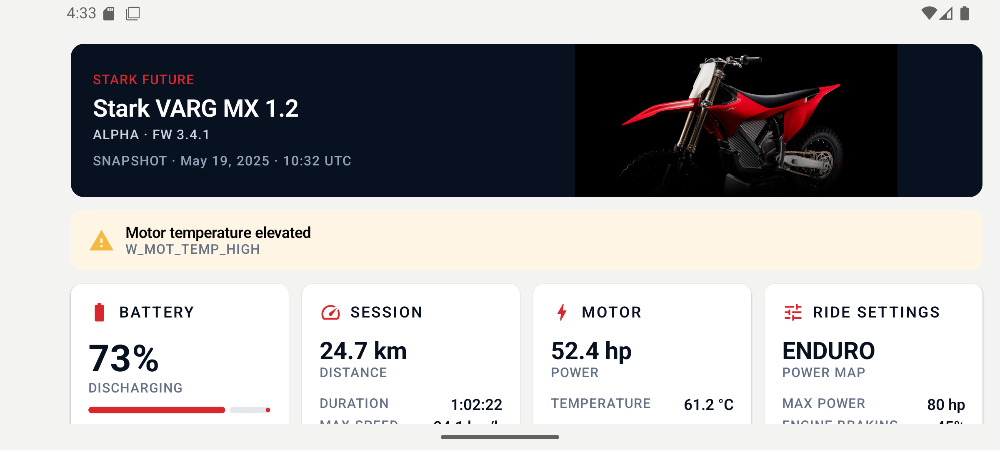

# Stark Telemetry

A focused Android dashboard for a single Stark VARG telemetry snapshot. The app reads the assessment payload from `assets`, validates it in the domain layer, and presents a high-contrast cockpit designed for a phone mounted horizontally on an off-road motorcycle.



## What is implemented

- Every field from the supplied snapshot: bike identity, firmware, timestamp, battery, motor, session, ride settings, warnings, and fault codes.
- Explicit Loading, Content, Empty, and Error states with retry handling.
- Fixed landscape orientation for the mounted-device use case.
- Responsive 4/2/1-column Compose grid for large, medium, and narrow windows.
- Remote bike image loading through Coil with a stable offline fallback; image failure never changes telemetry state.
- Accessible 48dp retry target, semantic test tags, safe drawing insets, high contrast, and warning communication that does not depend on colour alone.

## Architecture

The project deliberately stays in one Gradle module while preserving package boundaries:

```text
Compose UI
    ↓ intents / state
DashboardViewModel (MVI)
    ↓
LoadTelemetrySnapshotUseCase
    ↓
TelemetryRepository
    ↓
Asset source → JSON parser → DTO mapper
```

The dependency direction is `presentation → domain ← data`. DTOs and Android APIs do not cross into the domain model. Hilt owns production wiring; unit tests instantiate the same classes directly with fakes.

The presentation contract has one immutable `StateFlow<DashboardUiState>` and one user intent, `RetryClicked`. No navigation, effects channel, reducer framework, or persistence is needed for this single-screen snapshot.

## Run

Requirements: Android Studio with JDK 17 and Android SDK 37. The minimum supported Android version is API 26.

1. Open the repository in Android Studio.
2. Select an Android device or emulator.
3. Run the `app` configuration. `MainActivity` requests landscape automatically.

From the command line:

```bash
./gradlew assembleDebug
./gradlew installDebug
```

No API key or build-time configuration is required. Network access is optional and is used only for the hero image.

## Verification

```bash
./gradlew testDebugUnitTest
./gradlew connectedDebugAndroidTest
./gradlew lintDebug assembleDebug
```

The implementation was verified on a Pixel 6 AVD running API 36. Unit coverage includes parsing, repository result mapping, domain validation, formatting, UI mapping, and MVI transitions. Instrumented Compose tests cover required telemetry rendering and retry dispatch.

## Assumptions and scope

- The JSON contract represents exactly one current snapshot, not a history endpoint.
- Blank input is Empty; malformed input, arrays, `null`, missing required fields, and invalid types are InvalidData. Unknown extra fields are tolerated.
- Percentage values must be within `0..100`; time, distance, range, speed, and power must be non-negative. Temperature limits are not invented.
- Empty warnings and fault codes represent a healthy Content state.
- The assessment screenshots inform the cockpit hierarchy and restrained red accent, but are not copied as assets.
- Sliders, save actions, charts, Bluetooth, Modes, Trails, Maps, history, and a live backend are intentionally outside the supplied contract.

More rationale is in [docs/DECISIONS.md](docs/DECISIONS.md), and acceptance coverage is in [docs/TEST_PLAN.md](docs/TEST_PLAN.md).
